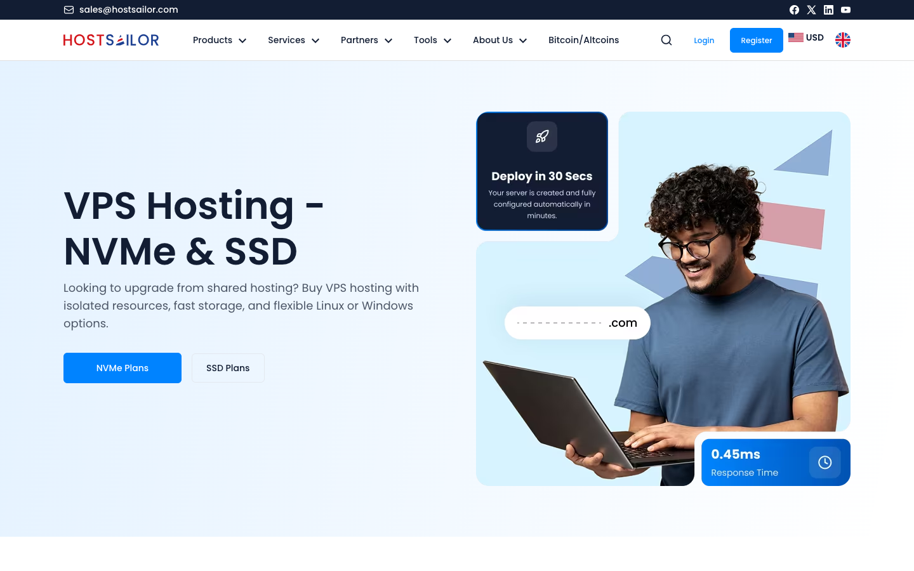
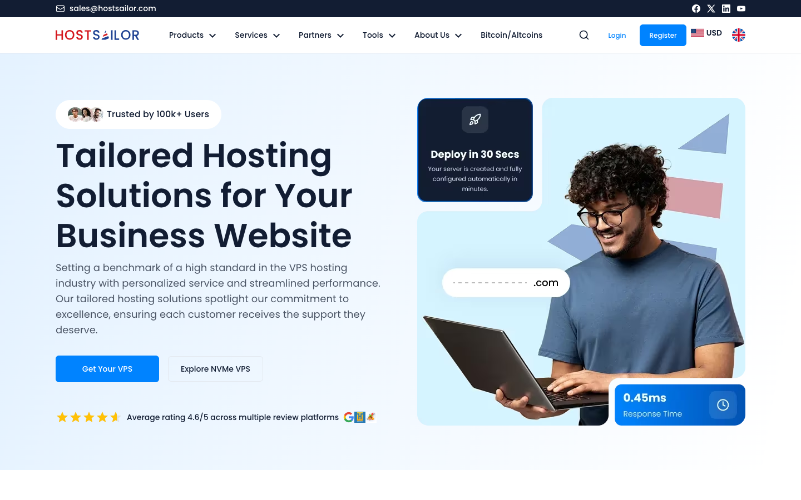
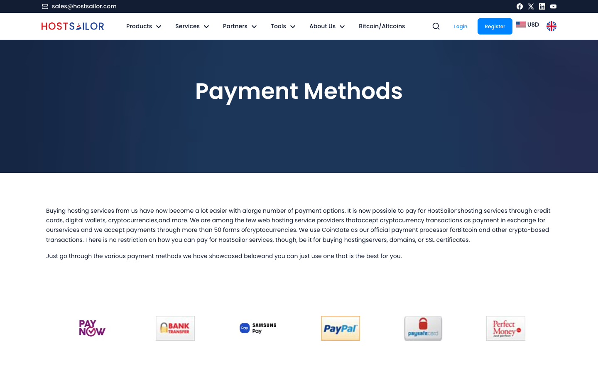

# HostSailor Review 2026: NVMe, SSD and Storage VPS from $1.95/Month

HostSailor stands out by separating three budget VPS jobs instead of forcing every buyer into one generic plan. Its public catalog advertises **NVMe VPS from $4.99/month**, **SSD KVM at $2.99/month** and **HDD Storage VPS from $1.95/month**.

**Quick verdict:** HostSailor is a useful low-cost alternative when you can match the storage type to the workload and want flexible payment options, including PayPal, bank transfer, cards and cryptocurrency.

[Compare HostSailor VPS products](https://clients.hostsailor.com/aff.php?aff=1529)

## HostSailor vs Vultr, Hetzner and annual VPS specials

Vultr is stronger for hourly lifecycle and API automation. Hetzner is a familiar European infrastructure reference. Annual-special providers can deliver a very low full-year bill for tiny Linux servers. HostSailor competes through **low monthly entry prices and distinct NVMe, SSD and storage lines**.

| Workload | Better HostSailor path |
|---|---|
| WordPress, database, Docker or frequent disk access | NVMe VPS |
| Small website, monitor, bot or test server | SSD KVM VPS |
| Backup, archive, logs or file storage | HDD Storage VPS |
| Ephemeral hourly compute | Developer cloud instead |

This product split is more useful than ranking all plans by the lowest number. The $1.95 storage product and the $4.99 NVMe product solve different problems.

## NVMe VPS: performance-oriented general hosting

The public NVMe offer starts at $4.99 per month and lists a Netherlands location, AMD EPYC, DDR5 memory, NVMe storage with RAID 10, dual-stack networking and broad OS compatibility including Linux and Windows.

Use it for WordPress, WooCommerce, a small database, Docker services, development environments and applications that read and write storage frequently.

## SSD KVM: inexpensive US general-purpose VPS

The SSD KVM offer is shown at $2.99 per month in the United States with Intel Xeon, DDR4 and SSD storage with RAID 10. It is the balanced choice for a personal site, monitoring, a bot, lightweight API or remote development box.

## HDD Storage VPS: capacity before IOPS

The Storage VPS starts at $1.95 per month and is positioned for inexpensive capacity. That makes it attractive for off-site backups, logs, archives and file staging—not latency-sensitive databases.

[Open the HostSailor order path](https://clients.hostsailor.com/aff.php?aff=1529)

## Netherlands or United States?

Choose the Netherlands for European visitors or the NVMe product profile. Choose the US SSD path for North American audiences and low-cost general workloads. The right region follows the users and external services connected to the VPS.

HostSailor markets fast deployment, but these remain self-managed VPS products. Operating-system updates, firewall rules, applications and external backups are part of the buyer's responsibility.

## Payment methods

HostSailor's public payment page lists cards, digital wallets, bank transfer, PayPal, Paysafecard and Perfect Money. It also states that CoinGate is used for Bitcoin and more than 50 cryptocurrencies.

That range is helpful for international buyers and crypto-funded projects. The final checkout determines which options are available for a particular order.

## Buying checklist

1. Pick NVMe, SSD or HDD storage based on the workload.
2. Match the Netherlands or US location to the audience.
3. Confirm OS compatibility, especially for Windows.
4. Check transfer, IP and add-on charges.
5. Read the current cancellation and refund rules for the product and payment method.

Activated VPS services should not be treated as a guaranteed free trial. Monthly billing keeps the commitment smaller, so begin with the lowest configuration that comfortably runs the application.

## Final recommendation

HostSailor is most convincing when the product line is chosen deliberately: **NVMe for websites and applications, SSD KVM for low-cost general compute, and Storage VPS for files and backups**. Buyers who also need PayPal or crypto payments get an additional practical benefit.

[Check current HostSailor VPS availability](https://clients.hostsailor.com/aff.php?aff=1529)

## FAQ

### What is the cheapest HostSailor VPS?
The public catalog advertises HDD Storage VPS from $1.95/month, SSD KVM at $2.99/month and NVMe VPS from $4.99/month.

### Does HostSailor accept Bitcoin?
Yes. Its payment page describes Bitcoin and more than 50 cryptocurrencies through CoinGate.

### Which HostSailor VPS is best for WordPress?
The NVMe line is the stronger default for a dynamic WordPress site because it prioritizes faster storage.
